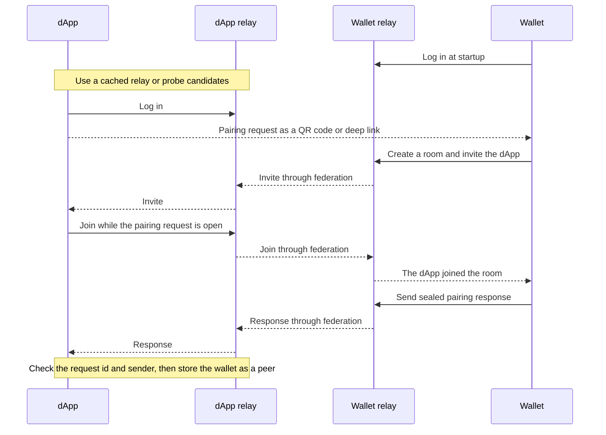
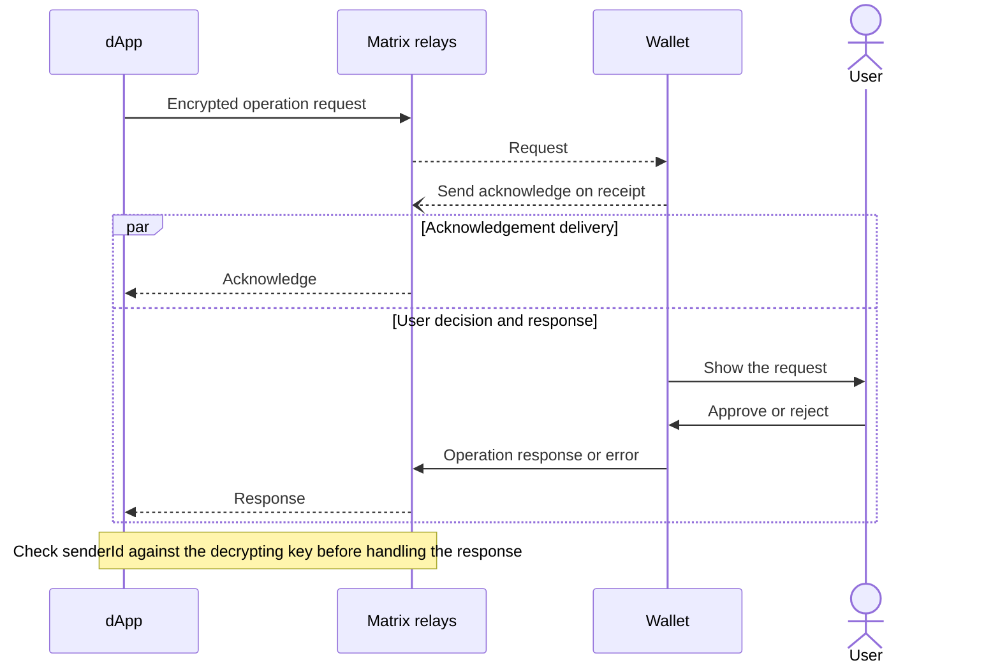

Taquito 25.1.3 uses Beacon `4.9.0-ecad-rc.0`. The relay selection described below follows that release.

`BeaconWallet` hides how it reaches a wallet. Most of the time that is what you want. When a connection hangs, a pairing fails on a phone, or you need to know what a relay operator can see, it helps to know what happens underneath. This page describes that for the Beacon SDK that Taquito ships, `@ecadlabs/beacon-*` from [ecadlabs/beacon-sdk-taquito-patches](https://github.com/ecadlabs/beacon-sdk-taquito-patches).

It replaces the old [p2p-direct flow page](https://docs.walletbeacon.io/advanced/flows/p2p-direct/) from the archived AirGap Beacon docs. That page shows two keys being swapped and leaves out the relay, the room, the pairing message and the acknowledgement.

The normative protocol is [TZIP-10](https://gitlab.com/tezos/tzip/-/blob/master/proposals/tzip-10/tzip-10.md). Where this page and the SDK disagree, the SDK source is what runs.

## Transports at a glance

Beacon can reach a wallet in three ways. Your dApp code is the same for all three: you call `requestPermissions()`, `sendOperations()` or `sign()`, and Beacon picks the transport.

| Transport | Used for | How the messages travel |
|---|---|---|
| postMessage | browser extension wallets, such as Temple | `window.postMessage` inside the page |
| P2P over Matrix | mobile, desktop and web wallets, such as Kukai web | encrypted text messages through a Beacon relay, which is a Matrix home server |
| WalletConnect 2 | wallets that support WalletConnect, such as Kukai iOS | the WalletConnect relay, with its own session keys |

The rest of this page is about the Matrix transport, because it is the one with moving parts you can see: relays, rooms and browser storage.

## Pairing over Matrix

Pairing creates a trusted link between one browser and one wallet. It happens once. After that, the dApp and the wallet reconnect on their own.

1. **The dApp picks a relay.** It tries a stored relay first. If it needs to discover one, it sends `GET /_synapse/client/beacon/info` to the configured relays in parallel. Each probe has a 10-second timeout. Discovery stops at the first successful response, when all probes fail, or after 60 seconds. The dApp caches the selected relay in `beacon:matrix-selected-node`.
2. **The dApp logs in.** Its Matrix user is `@<blake2b hash of its public key>:<relay>`. There is no sign-up. The password is a signature over `login:` plus the current five-minute window of the relay's clock. A plain Synapse rejects this login. A Beacon relay runs a module that checks the signature.
3. **The dApp shows a pairing request.** It is a QR code, or a deep link on mobile, with `tezos://?type=tzip10&data=<base58check JSON>`. The JSON has a fresh random `id`, the dApp's `name`, its `publicKey`, the protocol `version`, its `relayServer`, and an optional `icon` and `appUrl`. The dApp remembers the `id`.
4. **The wallet scans it.** The wallet logged in to its own relay, in the same way, when it started.
5. **The wallet creates a room and invites the dApp's Matrix user.** The dApp creates no room.
6. **The dApp joins the room**, but only because a pairing request is open. Outside of pairing, the dApp joins an invite only from a wallet it already knows. When the two sides use different relays, the invite and the join travel between the relays by Matrix federation.
7. **The wallet waits until the dApp has joined, then sends a pairing response**: `@channel-open:@<hash of dApp key>:<relay>:<sealed box>`. The sealed box holds `{ id, name, publicKey, relayServer, ... }`, encrypted to the dApp's public key. If the dApp never joins, the wallet gives up after about two and a half minutes with `No one joined after 200 tries`.
8. **The dApp checks the response and stores the wallet as a peer.** It opens the sealed box, then accepts the response only if:
   - its `id` is one the dApp issued in this tab in the last 30 minutes, and has not been used yet,
   - it comes from the Matrix user that owns the `publicKey` inside it.

   On success the dApp forgets all open request ids. It keeps at most 32 open ids at a time.

Pairing request ids live in memory only. If the browser reloads the page while the user is in the wallet app, the old QR code or deep link no longer works, and the user needs a new one. That is on purpose. An id kept in storage could be used twice, once in each tab.

### Pairing request fields

| Field | Meaning |
|---|---|
| `id` | random id for this request, used once |
| `name` | the `name` you pass to `BeaconWallet` |
| `publicKey` | the dApp's Ed25519 public key, in hex |
| `version` | Beacon protocol version |
| `relayServer` | the relay the dApp logged in to |
| `icon`, `appUrl` | optional, from your `BeaconWallet` options |

## Requests and responses

After pairing, each `BeaconWallet` call sends one request to the wallet. The wallet sends an `acknowledge` as soon as it decrypts the request, before the wallet app shows it to the user. The real response comes after the user decides. The wallet does not wait for the `acknowledge` to be delivered, so treat it as a sign that the request arrived, not as a guarantee that it comes before the response.

| `BeaconWallet` method | Beacon message |
|---|---|
| `requestPermissions()` | `permission_request`, answered by `permission_response` |
| `sendOperations()` | `operation_request`, answered by `operation_response` |
| `sign()` | `sign_payload_request`, answered by `sign_payload_response` |
| `disconnect()` | `disconnect`, with no answer |

The SDK also defines `broadcast_request`, `encrypt_payload_request`, `blockchain_request`, `change_account_request`, `proof_of_event_challenge_request` and `simulated_proof_of_event_challenge_request`, each with a matching `*_response` except `change_account_request`, plus `acknowledge`, `disconnect` and `error`. The [`BeaconMessageType`](https://github.com/ecadlabs/beacon-sdk-taquito-patches/blob/a6113ed4ef52454a17a89827ae70729ae8e6c2d1/packages/beacon-types/src/types/beacon/BeaconMessageType.ts) enum is the full list.

Only the wallet behind the active account can change the account or end the session. A paired wallet that is not active can remove only its own records.

## Encryption and what the relay sees

- **Pairing response.** A libsodium sealed box (`crypto_box_seal`) to the dApp's public key. Anyone with that public key can create one, which is why the dApp checks the request `id` and the sender.
- **Messages after pairing.** X25519 session keys from both public keys. Each message is a random 24-byte nonce plus a `secretbox` of the serialized Beacon message, in hex, sent as a plain `m.room.message` text event. Each side sends with its client session key and reads with its server session key.
- **Keys.** Each browser has one long-lived key pair, derived from a random seed stored in `beacon:sdk-secret-seed`. The key does not change between sessions. There is no forward secrecy: anyone who gets the seed can read old messages that a relay kept, and can act as the dApp.
- **Rooms.** Rooms use the `public_chat` preset. Matrix access control does not protect the messages. The encryption does.

The relay operator cannot read the messages. It does see:

- the raw public keys of both sides, because they are part of the login,
- who talks to whom, when, how much, and from which IP address,
- the encrypted history, for as long as the relay keeps it.

Since November 2026 the SDK also checks every message after pairing: the `senderId` inside it must match the key that decrypted it. Earlier versions did not check this, and did not check the pairing request `id`. See [GHSA-vh7x-6qwm-p785](https://github.com/ecadlabs/taquito/security/advisories/GHSA-vh7x-6qwm-p785).

## After upgrading from an affected version

`@taquito/beacon-wallet` 25.1.0 and earlier, and 25.2.0-beta0, accepted pairing responses that no request asked for. A peer added that way stays in browser storage after the upgrade. If your dApp ran an affected version, tell your users to clear the site's `beacon:` storage keys and pair again. 25.1.1 and 25.2.0-beta1 have the fix.

## Relay nodes

The default relays are `beacon-node-1.octez.io` to `beacon-node-8.octez.io`. You can add or replace relays with the `matrixNodes` option.

On the next connect, the dApp tries the cached relay first. If login fails, it tries other relays. After it has tried them all, it fails with `Could not connect to any beacon nodes`.

A relay is a Synapse home server with the Beacon login module. The reference setup, [airgap-it/beacon-node](https://github.com/airgap-it/beacon-node), is archived. Running your own relay is possible, but nobody supports it.

## Connection health

`BeaconWallet` reports the state of the transport through the transport status event. Its `health` is `ok` or `degraded`, and a `reason` tells you why the state changed: `sync_failing`, `token_renewed`, `session_deleted`, `session_expired` or `relay_changed`. See [Subscribing to events and observing lifecycle state](./wallet_API#subscribing-to-events-and-observing-lifecycle-state) for the code.

The dApp receives messages by long-polling the relay's `/sync` endpoint with a 30-second timeout. If a request hangs, or the laptop sleeps, or the tab comes back to the front, the client starts a new request.

## Browser storage

| Key | Holds |
|---|---|
| `beacon:sdk-secret-seed` | the seed for this browser's key pair |
| `beacon:communication-peers-dapp` | paired Matrix wallets |
| `beacon:postmessage-peers-dapp` | paired extension wallets |
| `beacon:accounts`, `beacon:active-account` | accounts from permission responses, and the active one |
| `beacon:matrix-selected-node` | the cached relay |
| `beacon:matrix-peer-rooms` | which room belongs to which peer |
| `beacon:sdk-matrix-preserved-state` | Matrix sync state |

`disconnect()` notifies the wallet, clears the active account and closes the transports. `clearActiveAccount()` removes only the active account and leaves the rest, including the cached relay. The [Disconnecting](./wallet_API#disconnecting) section explains when to use each.

## Troubleshooting

| What the user sees | Cause | What to do |
|---|---|---|
| `Could not connect to any beacon nodes` | every relay failed to log in | check the network; with `matrixNodes`, check that your relays answer `/_synapse/client/beacon/info` |
| `No server responded` | no configured relay answered successfully | check the network or a firewall that blocks `*.octez.io` |
| The QR code stops working after the phone switched apps | the browser reloaded the page during pairing, and pairing ids are kept in memory | show a new QR code or deep link |
| `No one joined after 200 tries` | the other side never joined the room, after about two and a half minutes | pair again; check that both sides reach their relays |
| Connection fails long after a logout | `clearActiveAccount()` was used as logout and the cached relay went offline | use `disconnect()` for logout; clear `beacon:` keys |
| A wallet appears that the user never paired, on a dApp built before 25.1.1 | an unsolicited pairing response from the time before the fix | upgrade, then clear `beacon:` keys and pair again |

## For wallet developers

If you build a wallet, use `@ecadlabs/beacon-wallet` and its `WalletClient` instead of writing the protocol yourself. The parts you would have to get right are all on this page: the login signature, the room, the sealed-box pairing response with the request `id` copied from the QR code, the session-key encryption and the `acknowledge` before each response. For Node and React Native, start from the SDK's [Node support notes](https://github.com/ecadlabs/beacon-sdk-taquito-patches/blob/a6113ed4ef52454a17a89827ae70729ae8e6c2d1/docs/node-support.md).
